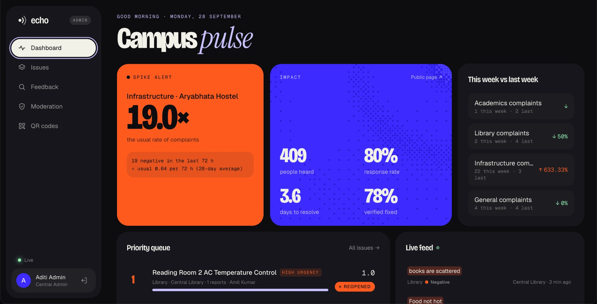
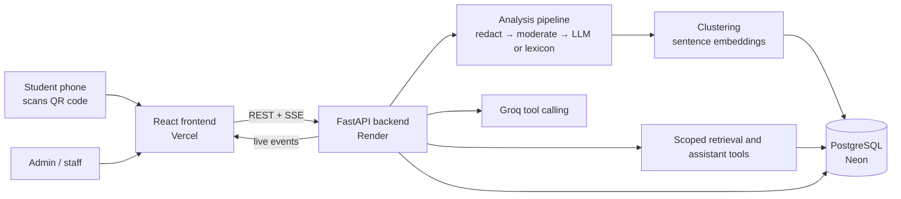

# Echo

**Every voice gets an answer.** A closed-loop campus feedback platform: students scan a QR code where a problem happens, AI turns their words into issues someone owns, staff answer in public, and the people who reported it confirm whether it actually got fixed.

**Live:** [echo.skipp.life](https://echo.skipp.life) · Vision2Web Full Stack Hackathon · Problem Statement 2 (Smart Feedback Analyzer)


## Contents

- [How it works](#how-it-works)
- [Features](#features)
- [Screenshots](#screenshots)
- [Tech stack](#tech-stack)
- [Architecture](#architecture)
- [Project structure](#project-structure)
- [Running locally](#running-locally)
- [Search and assistant demo](#search-and-assistant-demo)
- [Deployment](#deployment)
- [API overview](#api-overview)
- [Testing](#testing)
- [Team](#team)

## How it works

1. **Scan and report.** Every location has its own QR code. Scanning opens a form for that place, with its known issues listed so people can tap **Me too** instead of retyping.
2. **Understand.** Each report is redacted (phone numbers and emails removed), moderated, and split into aspects by an LLM: topic, category, sentiment and urgency. If the LLM is unavailable, a built-in lexicon analyzer takes over, so no report is lost.
3. **Group into issues.** Negative aspects are clustered with similar open issues at the same place using sentence embeddings, so 20 reports about the same Wi-Fi outage become one issue.
4. **Prioritize.** Each issue gets a transparent score, **Rw × N × U**: recency-weighted reports × share negative × urgency. Admins see why an issue ranks where it does.
5. **Resolve in public.** Staff move issues through *acknowledged → in progress → resolved* and must write a public response to resolve.
6. **Verify.** The people who reported it are asked whether it's actually fixed. If 30% or more say no (minimum 3 votes), the issue reopens automatically.

## Features

**For students (no account needed)**
- Location QR codes that open a prefilled feedback form
- One-tap **Me too** on existing issues
- A tracking code for every report, with a status timeline and the public response
- Fix verification: vote *fixed* or *not fixed* once an issue is resolved
- A public transparency page with response rate, time to resolve and verified-fix rate

**For admins and staff**
- Dashboard with spike alerts, week-over-week trends, a priority queue and a live feed
- Issue detail with the priority breakdown, evidence from reports, audit trail and assignment
- Moderation queue for spam, gibberish and abuse (redact and keep, approve or reject)
- Keyword and semantic feedback search with sentiment, topic, location, date and issue-status filters
- A private, tool-using assistant with follow-up history, clickable evidence and exact feedback counts
- Printable, full-screen QR codes for every location
- Live updates over server-sent events
- Role-based access: staff only see the issues assigned to them

**Safety and privacy**
- Recognized contact and registration patterns are redacted from feedback text. Optional reporter contact fields stay out of assistant evidence.
- The analysis pipeline has a lexicon fallback. Assistant tools treat stored feedback as untrusted data.
- Flagged feedback stays out of issues until an admin approves it
- Only reporters of an issue, who reported before the fix, can verify it, once per fix

## Screenshots

### Admin dashboard
Spike alerts, impact numbers, week-over-week trends, the priority queue and a live feed of incoming feedback.



### QR codes for every location
Each place gets a code. **Present** shows it full screen for printing or display; scanning opens the feedback form for that location.


## Tech stack

| Layer | Technology |
|---|---|
| Frontend | React 19, Vite, TypeScript, Tailwind CSS 4, GSAP, React Router |
| Backend | FastAPI, SQLAlchemy 2, Alembic, Pydantic |
| Database | PostgreSQL (Neon) with pgvector |
| AI analysis | Groq (Qwen by default; xAI Grok or Gemini also supported), VADER lexicon fallback |
| Clustering and semantic search | fastembed (all-MiniLM-L6-v2 sentence embeddings) |
| Assistant | Groq local tool calling with scoped retrieval and citation validation |
| Auth | JWT (python-jose) with bcrypt password hashing |
| Live updates | Server-sent events |
| Hosting | Vercel (frontend), Render (backend), Neon (database) |

## Architecture



Semantic search stores one versioned 384-dimensional vector per approved text report. Negative aspect vectors and issue centroids used by clustering still serve their original purpose. The migration adds a partial location/date index for vector-bearing rows. PostgreSQL filters eligible reports and ranks candidates by exact cosine similarity, `1 − cosine_distance`, from −1 to 1. Higher scores mean closer vectors. An issue's priority is calculated separately from its reports. The console shows the top 20 matches and the API supports up to 50.

The assistant passes scoped tool results to Groq and accepts only structured selections of records or one SQL count fact from the current turn. The UI displays reporter excerpts as quotations and renders issue metadata and totals directly from the server response. Staff can retrieve approved feedback through issues currently assigned to them. Raw reporter contact fields, tracking codes, staff names and issue notes stay out of model context.

Open **Count reports** to confirm location, category, sentiment and UTC dates. The API also accepts a rolling date range or issue-status filter in a structured count request. The server binds each fact to the confirmed filters, a fixed date window and the authenticated user's scope. The count includes approved feedback and eligible **Me too** reactions. A zero requires an executed aggregate query. Saved facts are rechecked before display, and answers from the former free-prose format require a new turn. Explicit counts also work with the model disabled.

The issue-detail tool returns at most one issue row and one SQL aggregate row. It counts distinct approved reports, with urgency calculated across all eligible aspects. No aspect preview is included. Use the linked issue view or filtered feedback search for individual records. The database still scans and groups the matching aspects to compute exact totals.

Exact search does work proportional to the eligible candidate set. The synthetic evaluations measure ranking quality on a small corpus. Capacity and latency on a production corpus are unmeasured. Search coverage depends on successful indexing, and short or multilingual reports can rank poorly with this model. The model selects evidence but can still choose incomplete or irrelevant records. A cited excerpt is a reported statement. Echo offers no free-text entailment check, and pattern-based injection filtering and redaction have incomplete coverage.

## Project structure

```
backend/
  app/
    main.py          app setup, CORS, startup tasks (connection warm-up, priority refresh)
    models.py        feedback, issues, users, conversations and messages
    auth.py          login, JWT, role checks
    routers/         public, issues, admin, stream, ask, semantic retrieval and assistant
    services/        analysis, llm, fallback, moderation, redact, cluster, priority,
                     lifecycle (issue linking, rescoring, verification rounds), spikes, stats
    seed.py          demo data (python -m app.seed)
    backfill_search.py  batch embedding indexer (python -m app.backfill_search)
  alembic/           database migrations
  evaluations/       synthetic datasets and evaluation CLIs
  tests/             pytest suite
frontend/
  src/pages/landing/ landing page sections
  src/pages/public/  Submit, Track, Transparency, Report
  src/pages/admin/   Admin pages including Feedback, FeedbackSource and Assistant
  src/lib/           API client, auth, live updates, types
  src/mocks/         in-memory mock API (VITE_USE_MOCKS=true)
docs/                team plan and screenshots
render.yaml          Render blueprint for the backend
```

## Running locally

**Requirements** include Python 3.12+, Node 20.19+ (or 22.12+), and a development PostgreSQL database with pgvector available. Use a dedicated [Neon](https://neon.tech) branch or a local PostgreSQL instance with the extension installed. For a local container, the pgvector project publishes the `pgvector/pgvector:pg17` image.

### Backend

```bash
cd backend
python3 -m venv .venv
source .venv/bin/activate
pip install -r requirements.txt
cp .env.example .env        # set DATABASE_URL and JWT_SECRET for the development database
alembic upgrade head
python -m app.seed          # optional synthetic demo data on an empty development database
python -m app.backfill_search
uvicorn app.main:app --reload --port 8000
```

On PowerShell, use `python -m venv .venv`, `Copy-Item .env.example .env` and the executables in `.venv\Scripts` if you prefer to skip activation.

The migration creates `vector` if needed. Have the database owner enable it first with `CREATE EXTENSION IF NOT EXISTS vector;` if the migration role lacks permission. New approvals and redactions update vectors with the saved feedback. Rejection, deletion or direct replacement of the text removes stale embeddings. The backfill is repeatable and independent of API startup. Use `--batch-size 16` to set the batch size and `--force` to rebuild existing vectors. MiniLM weights download on first use and can be cached with `FASTEMBED_CACHE_PATH`.

| Variable | Purpose |
|---|---|
| `DATABASE_URL` | PostgreSQL SQLAlchemy URL using `postgresql+psycopg://` |
| `JWT_SECRET` | Secret for signing login tokens |
| `GROQ_API_KEY` | LLM analysis (optional: without any key, the lexicon analyzer is used) |
| `GROQ_MODEL` | Optional model override (default `qwen/qwen3.8-27b`) |
| `XAI_API_KEY`, `GEMINI_API_KEY` | Alternative LLM providers, used if no Groq key is set |
| `ASSISTANT_GROQ_API_KEY` | Optional Groq key for assistant tool calls, configured separately from analysis |
| `ASSISTANT_GROQ_MODEL` | Tool-capable Groq model, defaults to `openai/gpt-oss-20b` |
| `FASTEMBED_CACHE_PATH` | Optional directory for the MiniLM model cache |
| `LOG_LEVEL` | Application log level, defaults to `INFO` |
| `CORS_ORIGINS` | Comma-separated frontend URLs allowed to call the API |

### Frontend

```bash
cd frontend
npm ci
cp .env.example .env
# Set VITE_USE_MOCKS=false and VITE_API_URL=http://localhost:8000 in .env
npm run dev                 # http://localhost:5180
```

| Variable | Purpose |
|---|---|
| `VITE_USE_MOCKS` | `true` runs on an in-memory mock API (no backend needed); `false` uses the real backend |
| `VITE_API_URL` | Backend URL, e.g. `http://localhost:8000` |
| `VITE_PUBLIC_URL` | Public site address used in QR codes; set it to the deployed URL so phones can open them |

### Demo accounts

The seed script creates these accounts, all with the password `demo1234`:

| Email | Role |
|---|---|
| `admin@echo.edu` | Admin |
| `rahul.wifi@echo.edu` | Staff, IT/Wi-Fi |
| `priya.mess@echo.edu` | Staff, Mess |
| `amit.hostel@echo.edu` | Staff, Hostel |

The staff console is at `/admin`. To see the fix-verification screen without submitting anything, open `/track/ECH-DEMO`.

## Search and assistant demo

1. Sign in with a seeded admin account. Open **Feedback**, choose **Semantic**, and search for “wireless internet disconnections.” Filter to **Aryabhata Hostel** and **Unresolved**. Open a feedback record and its linked issue. Switch to **Keyword** and try “Wi-Fi.”
2. Open **Assistant** and ask “Show recent Wi-Fi complaints.” With the assistant key configured, follow up with “Only at Aryabhata Hostel. Which issues remain unresolved?” Open a cited issue and ask why it is considered urgent.
3. Open **Count reports**, select a location and dates, and choose **Get count**. The result shows the exact total, filters, date window and access scope.
4. Run without the assistant key to try **Retrieval only** mode. It returns scoped semantic matches or keyword suggestions when semantic results are unavailable. Follow-up interpretation requires a configured model.
5. Sign in as the Wi-Fi staff account to verify assignment scoping. The assistant sends at most four previous user/assistant turns as context and retains the latest 20 turns per conversation. History hides answers when cited feedback is withdrawn or visible source access changes.

## Deployment

| Part | Host | Notes |
|---|---|---|
| Frontend | Vercel | Root directory `frontend`; `vercel.json` rewrites routes to the SPA. Set `VITE_API_URL`, `VITE_USE_MOCKS=false` and `VITE_PUBLIC_URL`. |
| Backend | Render | `render.yaml` blueprint in Ohio. Set `DATABASE_URL`, `JWT_SECRET`, `CORS_ORIGINS` and any provider keys in the service environment. |
| Database | Neon | PostgreSQL in AWS us-east-2 with `vector` enabled |

For a future release, validate `alembic upgrade head` and the backfill on an isolated Neon branch. Apply the schema migration before starting code that references the new columns. Run `python -m app.backfill_search` as a one-off job against the intended database after migration. Verify indexed records and authenticated search on the staging frontend before promoting it. Backfill stays outside the web process startup.

## API overview

All routes are under `/api`. Errors share one shape: `{"error": {"code", "message", "fields"}}`.

| Area | Endpoints |
|---|---|
| Public | `GET /locations/public`, `GET /locations/{slug}`, `GET /locations/{slug}/issues`, `POST /feedback`, `POST /issues/{id}/metoo`, `GET /track/{code}`, `POST /track/{code}/verify`, `GET /public/stats`, `GET /public/issues`, `GET /public/ticker` |
| Auth | `POST /auth/login`, `GET /auth/me` |
| Issues | `GET /issues`, `GET /issues/{id}`, `PATCH /issues/{id}`, `GET /users` |
| Admin | `GET /dashboard/summary`, `GET /analytics/summary`, `GET /alerts`, `GET /feedback`, `GET /moderation/queue`, `PATCH /feedback/{id}/moderation` |
| Live | `GET /stream` (server-sent events, admins only, `Authorization: Bearer …` header) |
| Search | `GET /feedback` (keyword), `GET /feedback/semantic`, `GET /feedback/sources/{id}`, `POST /ask` (existing filter suggestions) |
| Assistant | `GET /assistant/conversations`, `PUT /assistant/conversations/{uuid}`, `GET /assistant/conversations/{uuid}`, `POST /assistant/conversations/{uuid}/messages` |

Interactive API docs are served at `/docs` on the backend.

The browser shares one fetch-based event stream across admin views and reconnects with backoff after transport errors. Authentication or permission failures stop retries. The API rejects query-string credentials and strips the stream query from Uvicorn access logs. Proxies and other upstream loggers need their own query-redaction configuration. An older frontend using query-string authentication must be refreshed to connect to the updated API.

## Testing

```bash
cd backend
source .venv/bin/activate
pip install pytest
python -m pytest -q
python -m evaluations.analysis
python -m evaluations.retrieval
python -m evaluations.assistant
```

In `frontend`, run `npm ci` then `npm run build` with `VITE_USE_MOCKS=false` to type-check and build the connected frontend. The deterministic tests stub provider responses and use isolated in-memory fixtures. Set `ECHO_TEST_POSTGRES_URL` to an already migrated disposable PostgreSQL database to include the pgvector integration test. See the [evaluation guide](backend/evaluations/README.md) for model setup, metrics and explicit `--live` commands.

With Node 22+, run `node --experimental-strip-types --test tests/eventStream.test.mjs` from `frontend` to test SSE framing across chunk boundaries and the frame-size bound.

## Team

| Area | Owner |
|---|---|
| Frontend | Nikhil |
| Backend: analysis & intelligence | Aaditya |
| Backend: platform API & data | Aditi |
